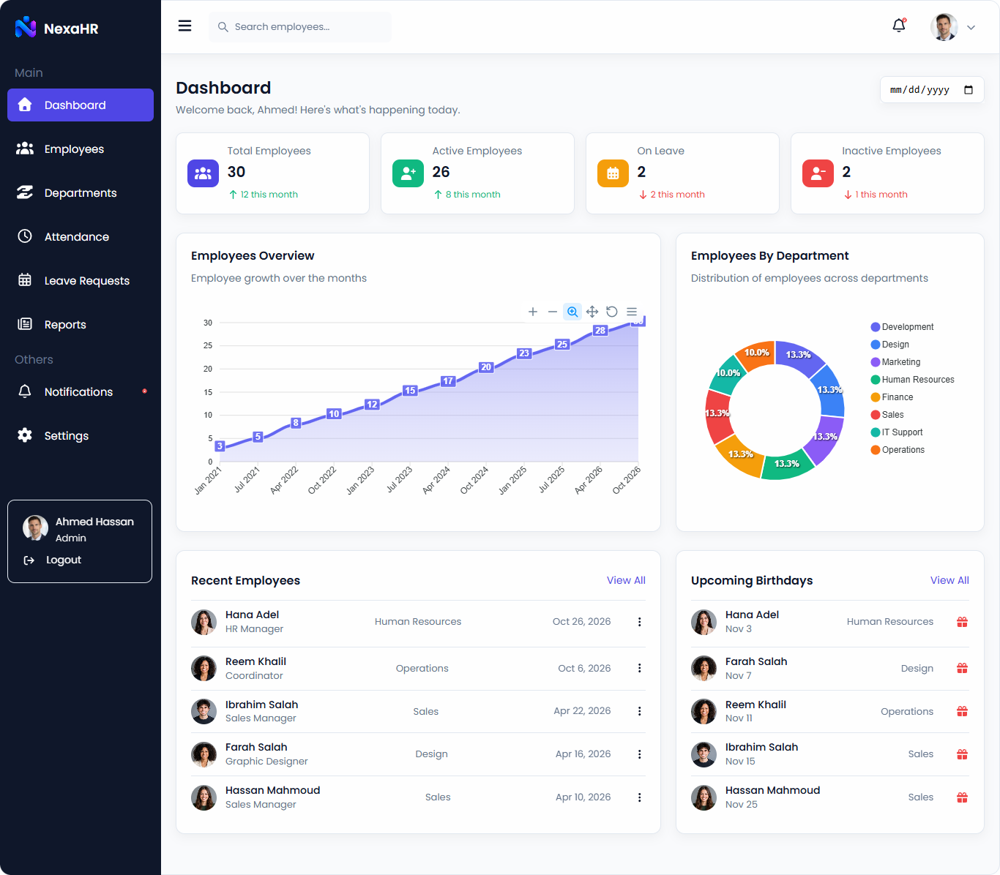
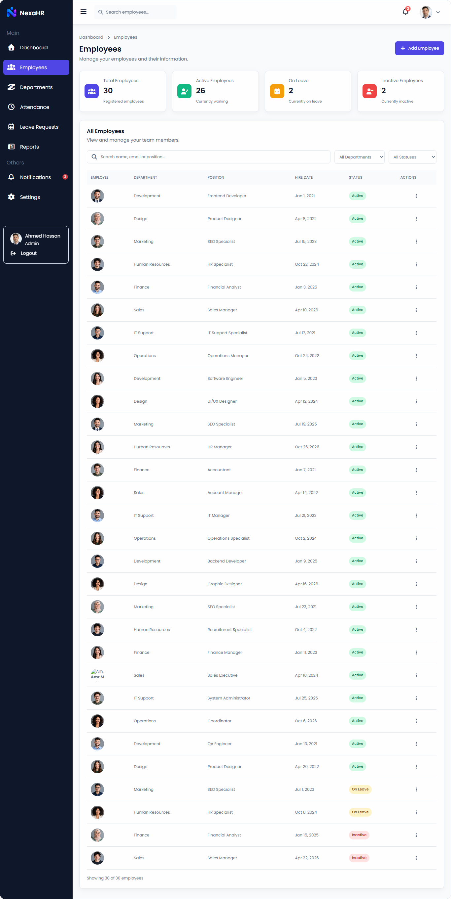
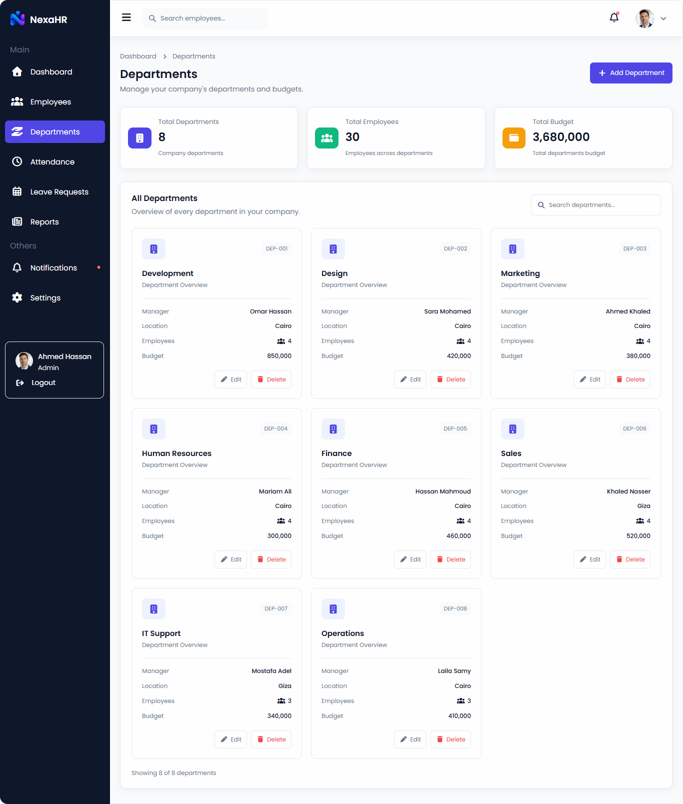
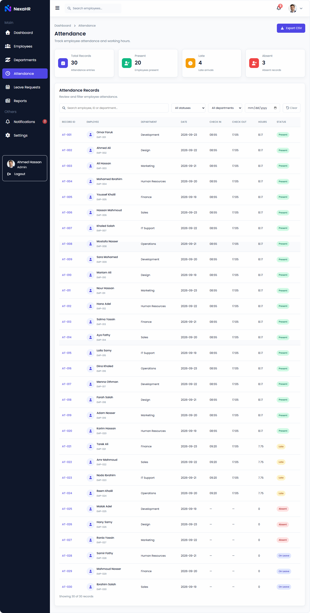
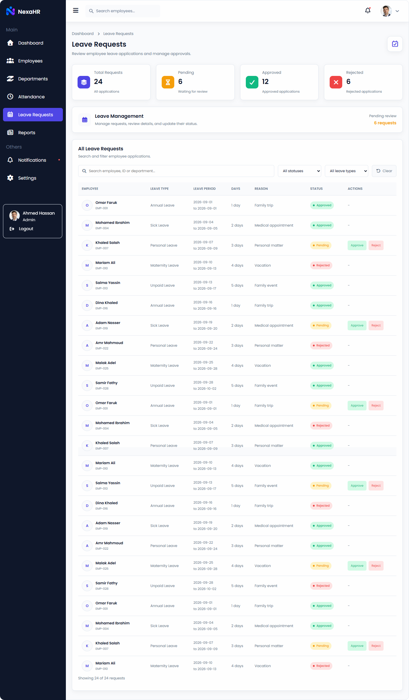
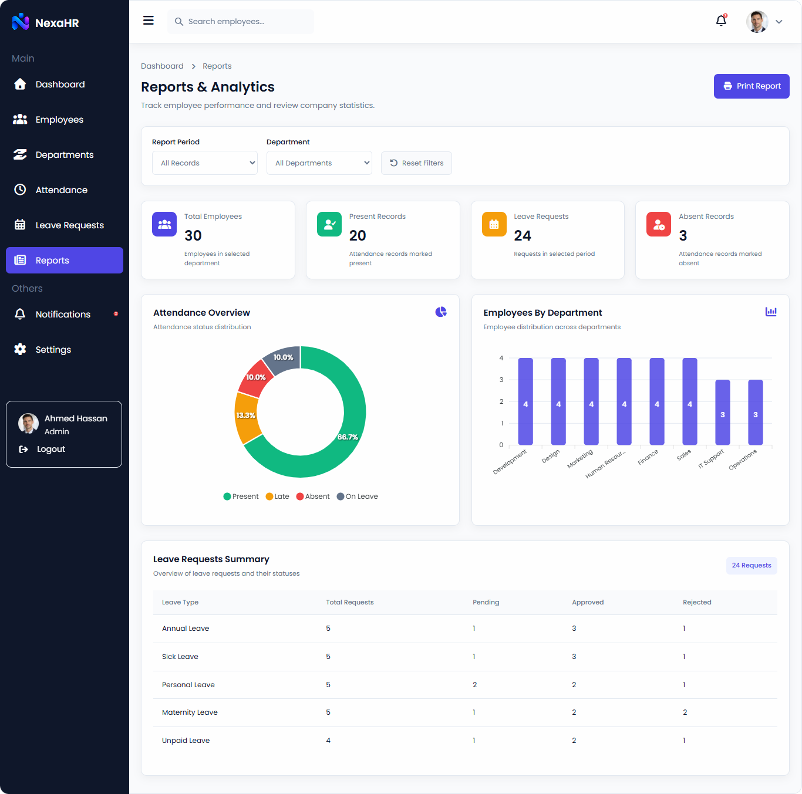
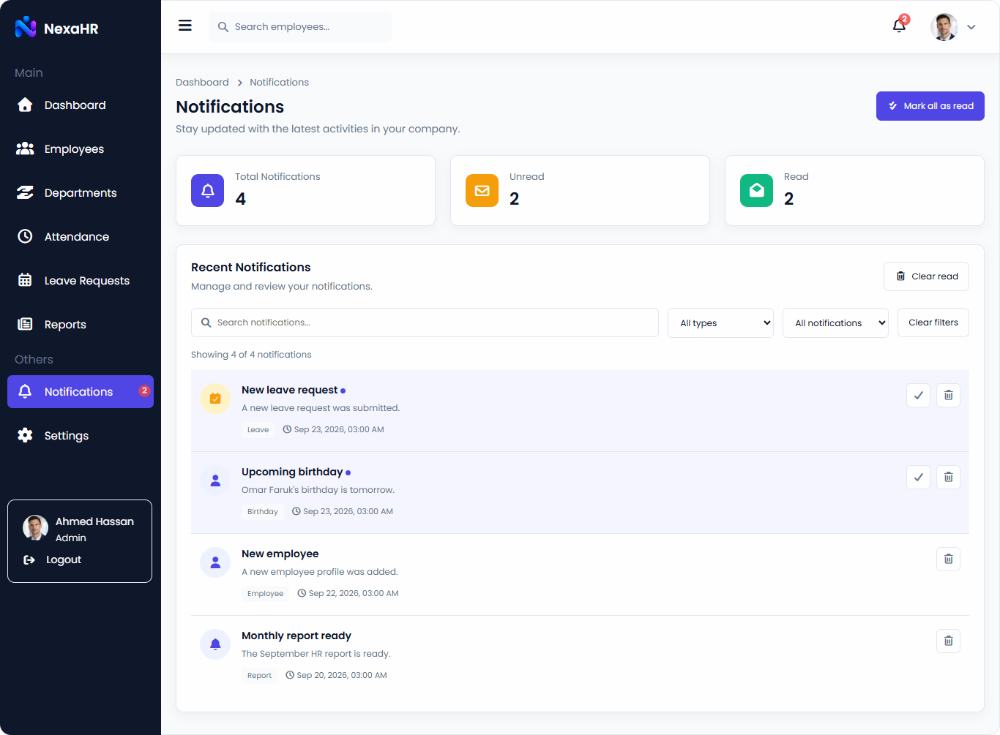
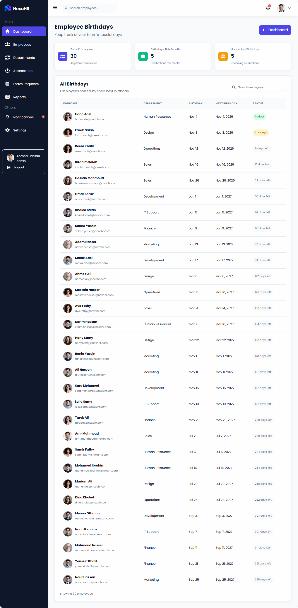
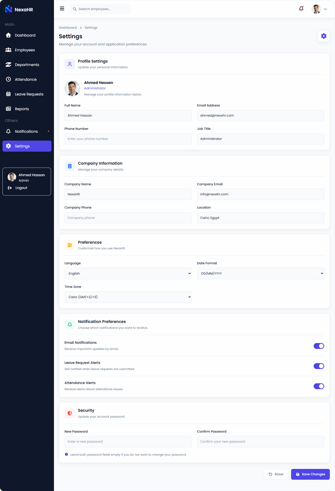
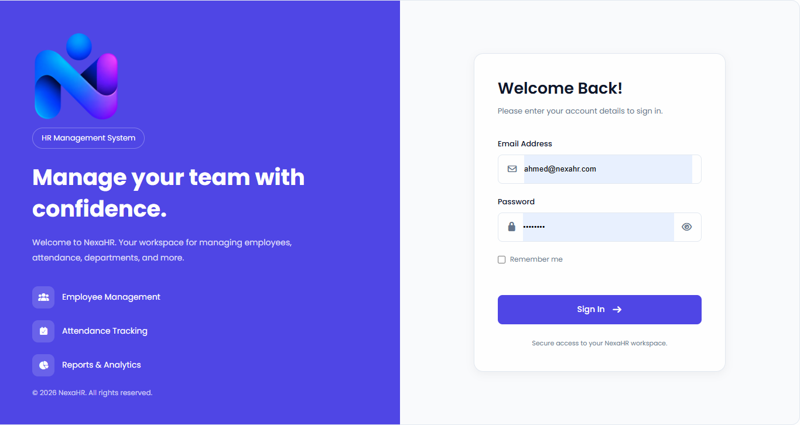

# NexaHR – Human Resource Management System

A modern and responsive Human Resource Management Dashboard built using HTML, CSS, and JavaScript. NexaHR helps manage employees, departments, attendance, leave requests, reports, notifications, and company settings through a clean and user-friendly interface.

## 🚀 Live Demo

[View Live Demo](https://zulkifliahmed.github.io/Dashboard-NexaHR/login.html)

## 📸 Screenshots

### 1. Dashboard

### 2. Employees

### 3. Departments

### 4. Attendance

### 5. Leave Requests

### 6. Reports

### 7. Notifications

### 8. Birthdays

### 9. Settings

### 10. Login

## ✨ Features

- **Dashboard:** Overview of employee statistics and company activities.
- **Employees Management:** Add, edit, delete, search, and filter employee records.
- **Departments:** Manage company departments and employee distribution.
- **Attendance:** Track employee attendance and manage attendance records.
- **Leave Requests:** Review and manage employee leave requests.
- **Reports:** Display employee statistics and department reports using charts.
- **Notifications:** View, search, filter, and manage notifications.
- **Birthdays:** Display employee birthdays.
- **Settings:** Manage profile and application settings.
- **Login System:** Demo login with email and password validation.
- **Remember Me:** Keep the login status using localStorage and sessionStorage.
- **Authentication:** Redirect unauthenticated users to the login page.
- **Logout:** Clear login data and redirect to the login page.
- **Responsive Design:** Optimized for desktop, tablet, and mobile screens.

## 🛠️ Technologies Used

- HTML5
- CSS3
- JavaScript (ES6+)
- JSON
- LocalStorage & SessionStorage
- ApexCharts
- Font Awesome
- Google Fonts (Poppins)
- Git & GitHub

## 📁 Project Structure

NexaHR/
│
├── assets/
│   ├── images/
│   └── logo.png
│
├── css/
│   ├── all.main.css
│   ├── main.css
│   ├── dashboard.css
│   ├── employees.css
│   ├── departments.css
│   ├── attendance.css
│   ├── leaveRequests.css
│   ├── reports.css
│   ├── notifications.css
│   ├── birthdays.css
│   ├── settings.css
│   └── login.css
│
├── js/
│   ├── all.main.js
│   ├── main.js
│   ├── dashboard.js
│   ├── employees.js
│   ├── departments.js
│   ├── attendance.js
│   ├── leaveRequests.js
│   ├── reports.js
│   ├── notifications.js
│   ├── birthdays.js
│   ├── settings.js
│   └── login.js
│
├── data.json
├── index.html
├── employees.html
├── departments.html
├── attendance.html
├── leaveRequests.html
├── reports.html
├── notifications.html
├── birthdays.html
├── settings.html
├── login.html
└── README.md

## 🔐 Demo Login Credentials

Use the following credentials to access the application:

| Field | Value |
|---|---|
| Email | ahmed@nexahr.com |
| Password | Admin123 |

**Note:** This is a front-end demo authentication system. It does not use a backend server or secure production authentication.

## ⚙️ Getting Started

### 1. Clone the repository

git clone https://github.com/ZulkifliAhmed/Dashboard-NexaHR.git

### 2. Navigate to the project folder

cd Dashboard-NexaHR

### 3. Run the project

Open the project using Visual Studio Code and launch it with the Live Server extension.

**Note:** Use a local server to ensure that `data.json` loads correctly through the Fetch API.

## 📊 Data Management

- Employee and company data are loaded from `data.json`.
- LocalStorage is used to persist selected application data.
- SessionStorage is used to manage temporary login sessions.
- JavaScript handles data rendering, filtering, searching, and interactions.

## 👨‍💻 Author

**Zulkifli Ahmed**

- GitHub: [@ZulkifliAhmed](https://github.com/ZulkifliAhmed)

## 📄 License

This project was developed for educational and portfolio purposes.